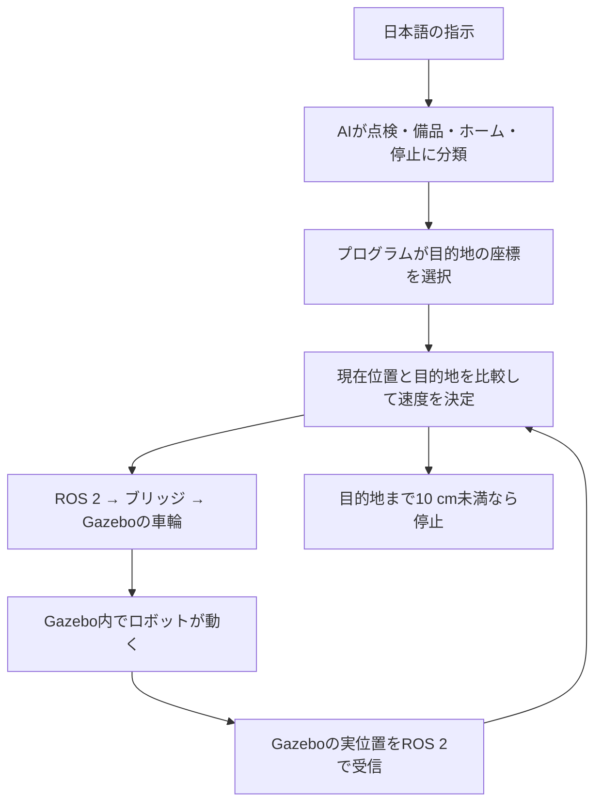

# 3分でわかる：今回のロボットは何をしているか

**日本語の指示をAIで分類し、その結果に応じて、仮想ロボットを決められた場所まで走らせる作品です。**
実機は使いません。点検や清掃そのものではなく、その場所までの移動を作りました。

## 何を使ったか

|道具|今回の役割|
|---|---|
|Docker Desktop|Windowsの中に、この課題専用のLinux実行環境を用意する|
|Gazebo Harmonic|床・車輪・ロボットを作り、物理的な動きを計算するシミュレータ|
|ROS 2 Jazzy|「移動速度」「現在位置」などをプログラム間で受け渡す仕組み|
|ros_gz_bridge|ROS 2とGazeboで異なるメッセージ形式を変換する接続役|
|Python＋scikit-learn|日本語の指示を分類する小さなAIと、走行制御を実装する|
|Jupyter Notebook|学習・走行・動画確認を順番に実行できる操作ノート|

今回の処理は軽いため、このPCのCPUで実行しました。RTX 4090やColabは使用していません。

## 「点検エリアへ移動してください」が届くと

例えば「点検」と分類されたら、プログラムが登録済みの座標 `(2.0, 0.0)` を選びます。
ロボットは約0.05秒ごとに「どちらを向くか」「どの速さで進むか」を計算します。
目的地に近づくほど減速し、距離が10 cm未満になれば止まります。これを**フィードバック制御**と呼びます。

## どこがAIなのか

**AIが担当するのは、指示文の分類です。** 自作の40文に正解ラベルを付けて学習させました。

- **TF-IDF**：文に出てくる文字や文字の並びを、計算できる数値に変換します。
- **ロジスティック回帰**：その数値から、4種類の指示のどれに近いかを予測します。
- 分類スコアが0.60未満なら、未対応の指示として停止します。

座標の選択と走行制御は、人が書いたルールです。AIが地図や走り方を学習したわけではありません。
また、実行中にChatGPTへ問い合わせる仕組みもありません。Codexはコードと説明資料の作成に利用しました。

## 動画の見方

1. **点検（オレンジ）→備品（緑）→ホーム（青）**の順で移動します。
2. 右側の「AIの推論結果」で指示の分類、「x・y」で現在位置を確認できます。
3. 「ARRIVED」は到着、「STOPPED」は停止です。
4. 「ダンスを踊って」は未対応と判定され、停止したままになります。

動画は75.1秒。左側はGazeboの仮想カメラの実画像です。
**デモでは、用意した指示文をプログラムが順番に送ります。** 音声認識や、人がその場で入力した操作を録画したものではありません。
手動で文を送る手順はREADMEにあります。

## 何が確認できて、何がまだできないか

3地点すべてに到着し、誤差は約9.9 cmでした。学習に使わなかった8文も正しく分類しました。
ただし、似た語彙の少数の文での確認です。自由な日本語を何でも理解できるわけではありません。

現在位置はGazeboが持つ実位置を使っています。実機のようにカメラやセンサーから自己位置を推定する処理はありません。
障害物回避、物をつかむ動作、汚れの認識、清掃は今後の課題です。カメラは録画用で、AIの視覚認識には使っていません。

## 自分で確認する最初の一歩

`Step1.ipynb`を開き、まず「2. 指示を変えてみる」の文を変更して実行してください。
ここは**分類だけ**を確認するセルなので、ロボットは動きません。「3. 実際にGazeboで走行・録画」で自動デモを実行します。

デモの再実行では動画と走行ログが更新されます。提出版を残す場合は先にコピーしてください。

説明するときは、次の3文で十分です。

> 日本語の指示を機械学習で4種類に分類しました。
> ROS 2で速度指令を送り、Gazebo上のロボットを指定地点へ移動させました。
> 現在位置を確認して到着時に停止し、映像とログで結果を検証しました。
